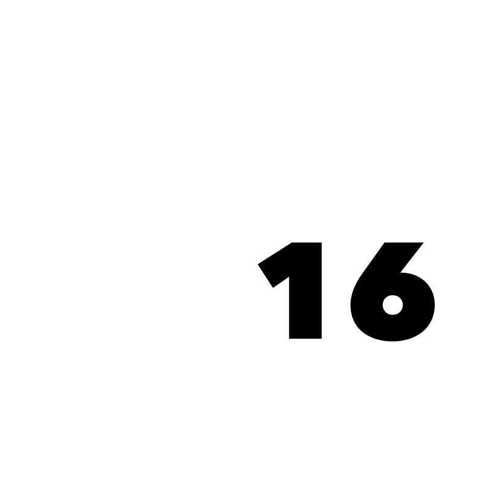
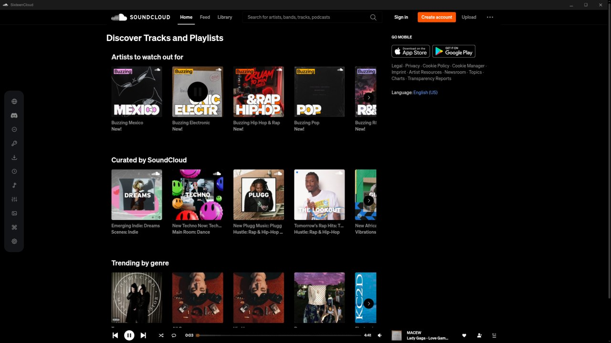
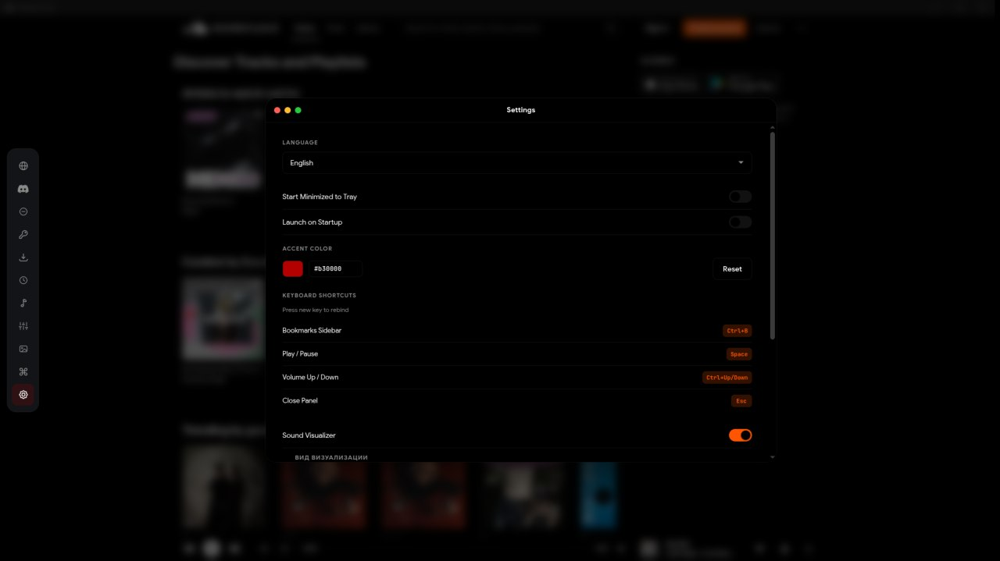
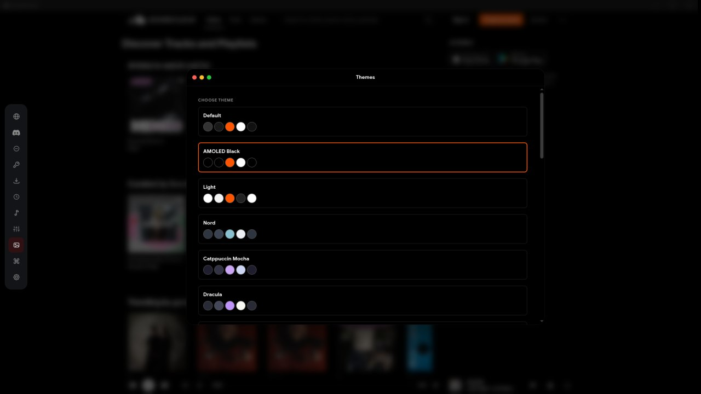
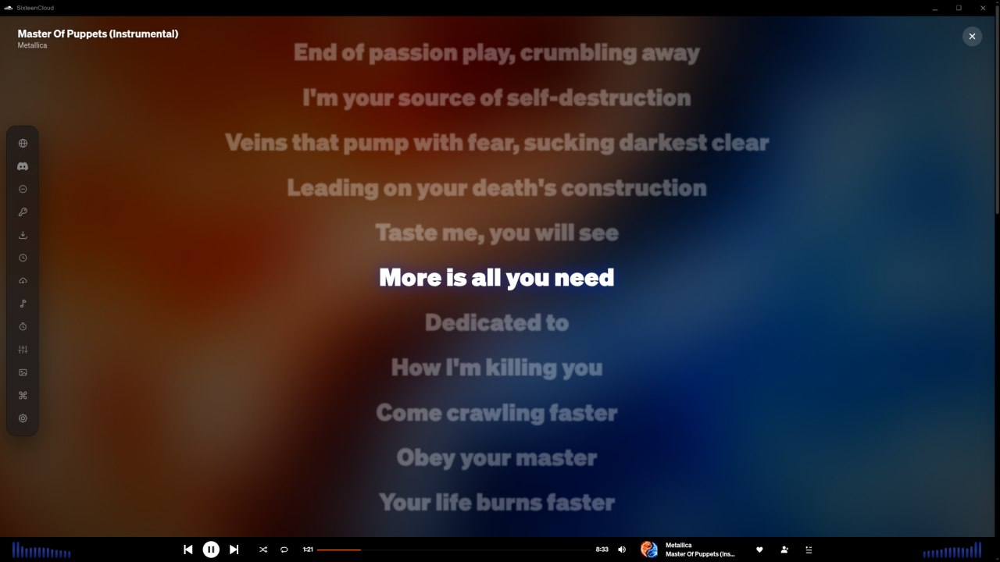
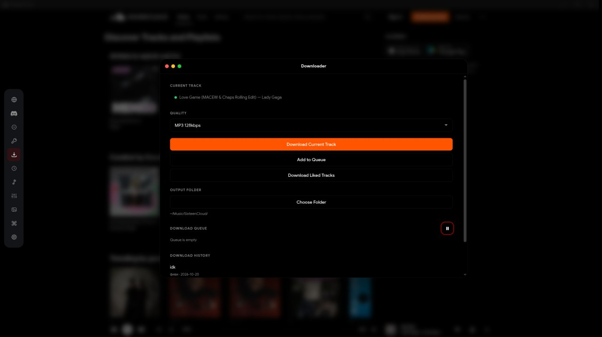
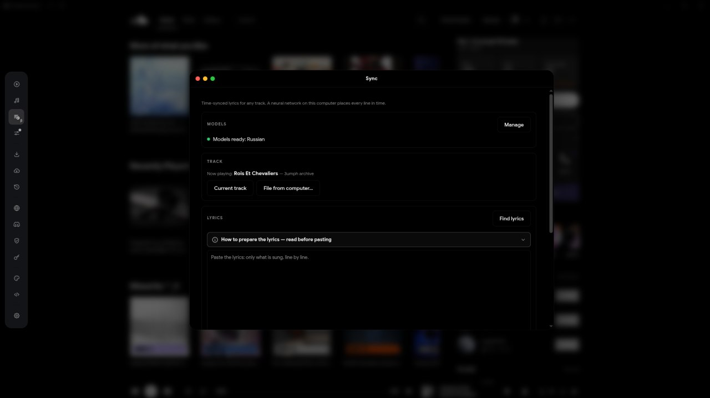
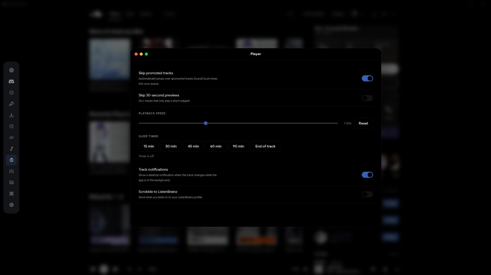
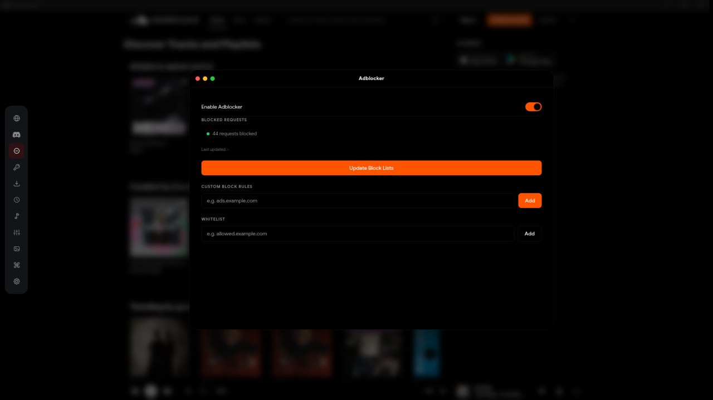
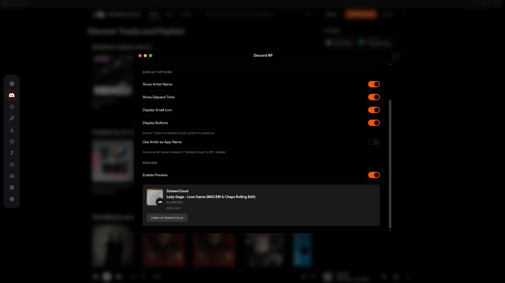

<div align="center">



# SixteenCloud

**A desktop SoundCloud client that feels native.**
Ad-free playback · synced lyrics · 10-band EQ · visualizer · downloads · Discord RPC

[](https://github.com/npukolno/sixteencloud/releases/latest)
[](https://github.com/npukolno/sixteencloud/releases)
[](#install)
[](LICENSE)

[Install](#install) · [Features](#features) · [Screenshots](#screenshots) · [Build from source](#build-from-source)

</div>

---

SixteenCloud wraps the SoundCloud web player in Electron and adds the parts a music app should have: a real tray, media keys and MPRIS on Linux, a proper mini player, offline downloads, synced lyrics, an equalizer, themes and in-app updates. It targets Linux first, with Windows and macOS builds from the same codebase.

> Unofficial client. Not affiliated with, endorsed by, or sponsored by SoundCloud.

## Screenshots



### Settings and appearance

| Settings | Themes |
| :---: | :---: |
| <br>*Language, accent color, keybinds, visualizer* | <br>*Default, AMOLED Black, Light, Nord, Catppuccin Mocha, Dracula* |

### Playback tools

| Synced lyrics | Downloader |
| :---: | :---: |
| <br>*Full-screen synced lyrics over a blurred cover backdrop* | <br>*Queue, quality presets, output folder, history* |

### Lyrics sync (beta)


*Make time-synced lyrics for any track: models on your computer place every line in time*

### Player tools


*Skip promoted tracks and previews, playback speed, sleep timer, notifications, ListenBrainz*

### Integrations and protection

| Adblocker | Discord Rich Presence |
| :---: | :---: |
| <br>*Request blocking, custom rules, whitelist* | <br>*Track, artist, elapsed time and buttons* |

## Features

- **Ad-free playback** — request filtering plus cosmetic cleanup of promoted content.
- **Synced lyrics** — LRC from LRCLIB, NetEase and QQ; plain lyrics from Genius, Musixmatch, lyrics.ovh, AZLyrics, ChartLyrics and lyrist. Smarter track matching, a sync-offset slider, an "other versions" picker and a blurred full-screen mode with ±0.5 s sync nudges, a version switcher and the cover next to the title.
- **Lyrics sync (beta)** — make your own time-synced lyrics for a track that has none. Find or paste the text, and speech models running on your computer place every line and word against the audio, with a verdict on how well the track was recognised. The Russian and English models download on demand from the Sync tab and can be removed at any time; the job runs in the background. Results are saved to a library and offered first among the lyrics versions, in the panel and in full screen.
- **Player tools** — skip promoted tracks and 30-second previews, resume where you left off after a restart, playback speed, sleep timer, seek steps of 5–30 s, an A–B loop (`Alt+J` / `Alt+L` / `Alt+K`, rebindable), track-change notifications and ListenBrainz scrobbling.
- **Player bar shortcuts** — Lyrics, Download and Save offline buttons right next to the cover in SoundCloud's own player bar.
- **Accent from cover art** — the whole interface can take its colour from the playing track.
- **Search shortcuts** — `/` or Ctrl+K focuses search; recent queries open as a dropdown.
- **10-band equalizer** — presets and custom curves, plus a preamp and a limiter / loudness leveller. It runs on a master bus that every track flows through, so it stays applied across track changes.
- **Audio visualizer** — side bars, centre bars, progress wave, kick-reactive cover glow, oscilloscope, window edge glow, retro LED meter and a spectrogram behind the player. All driven by the real analyser node and coloured from the cover art.
- **Downloads** — single tracks, playlists (three tracks at a time, packed into a zip), all your likes and the current play queue. Streamed straight to disk, HLS-aware, tagged with cover art, with a queue, progress and history.
- **Mini player** — always-on-top window that follows your theme and accent, with like and lyrics buttons.
- **Feed without reposts** — show, fold or hide reposts in the home feed.
- **Discord Rich Presence** — current track, artist and artwork.
- **Linux integration** — tray, MPRIS (`org.mpris.MediaPlayer2.sixteencloud`), media keys, desktop entry, notification controls.
- **Windows taskbar** — previous / play-pause / next under the window thumbnail and track progress on the taskbar button.
- **Battery saver** — on battery power the visualizer, blur and animations switch off (can be disabled in Settings).
- **Side panel that stays out of the way** — grouped icons with live status dots (EQ, geo proxy, downloads); the page makes room for it on mid-size windows, tucks it behind an edge handle on narrow ones; `Ctrl+G` hides it.
- **Titlebar** — back, forward and reload, plus live chips for the sleep timer, the geo proxy and download progress.
- **Toasts and ambient glow** — short in-app confirmations and a soft glow from the cover colours above the player bar.
- **Bookmarks sidebar** — saved tracks, sets and profiles with covers, pins, folders, drag to reorder and timecode bookmarks for long mixes.
- **Themes & accents** — accent color, dark/light, custom CSS.
- **Geo-unblock** — optional proxy routing for region-locked catalogs.
- **History** — locally stored listening history with search.
- **Settings backup** — export or import the whole profile (themes, custom CSS, EQ presets, bookmarks, keybinds, adblock rules) as one JSON file. Tokens are never included.
- **Tokens in the OS keychain** — the SoundCloud and ListenBrainz tokens are encrypted with the system keyring when one is available.
- **Auto-update** — Windows and AppImage builds check GitHub Releases (Windows builds are unsigned, so SmartScreen warns before the first run).

## Install

Grab the latest asset from [Releases](https://github.com/npukolno/sixteencloud/releases/latest).

### Windows

Download **`SixteenCloud.Setup.3.1.0.exe`** and run it. The installer is per-user and does not require administrator rights. If SmartScreen warns about an unsigned publisher, choose **More info → Run anyway**.

### Linux

| Format | Install |
| --- | --- |
| **AppImage** | `chmod +x SixteenCloud.Setup.3.1.0.AppImage && ./SixteenCloud.Setup.3.1.0.AppImage` |
| **Debian / Ubuntu** | `sudo dpkg -i SixteenCloud.Setup.3.1.0.deb` then `sudo apt -f install` if needed |
| **Arch / pacman** | `sudo pacman -U SixteenCloud.Setup.3.1.0.pacman` |

On Wayland, if the window does not appear, launch with `--ozone-platform=wayland` or run under XWayland.

### macOS

Download **`SixteenCloud.Setup.3.1.0.zip`**, unzip and drag `SixteenCloud.app` to Applications. The build is unsigned and x86_64 only; clear the quarantine flag once:

```bash
xattr -dr com.apple.quarantine /Applications/SixteenCloud.app
```

## Auto-update

| Build | Update path |
| --- | --- |
| Windows (NSIS) | In-app banner → download → restart. Installs silently. |
| Linux AppImage | In-app banner → download → restart. |
| Linux deb | In-app update downloads the package; installing may require privileges. |
| Linux pacman | Not auto-installed by the app — update the package manually. |
| macOS zip | Manual replacement (unsigned builds cannot self-install). |

Updates are read from GitHub Releases of this repository. Older 2.x builds migrate to 3.1.0 through the same release feed.

## Build from source

Requirements: Node.js 20+ and npm. Linux packaging additionally needs standard Electron build tooling (`fakeroot`, `dpkg`, `rpm` optional); macOS `.dmg` creation must run on macOS.

```bash
git clone https://github.com/npukolno/sixteencloud.git
cd sixteencloud
npm ci
npm run typecheck
npm run lint
npm test
npm start
```

Packaging:

```bash
npm run package:linux   # AppImage + deb + pacman → release/
npm run package          # Windows NSIS → release/ (run on Windows or Wine-capable CI)
npm run package:mac      # macOS zip → release/ (unsigned; run on macOS for signing/notarization)
```

Code-signing material is supplied through electron-builder environment variables or CI secrets. `certs/`, private keys and `release/` are never committed.

## Project layout

| Path | Purpose |
| --- | --- |
| `src/main/` | Electron main process, one module per concern: window, adblocker, geo-bypass, input, mini-player, overlays, updater, Linux integration |
| `src/main/ipc/` | IPC handlers: store and secrets, downloader, lyrics, auth, scrobbling, settings backup; pure validators and parsers are unit-tested |
| `src/preload/` | Sandboxed preload bridges (`preload.ts`, `mini-preload.ts`) |
| `src/renderer/overlays/` | Injected overlay UI (titlebar, sidebar, lyrics, EQ, settings, visualizer) |
| `src/renderer/mini-player/`, `src/renderer/page/` | Mini-player window and page scripts written as TypeScript and bundled with esbuild |
| `src/shared/` | Types, constants, i18n, user-agent |
| `native/pulse-sixteencloud.c` | `LD_PRELOAD` shim that brands the PulseAudio stream |
| `assets/` | Icons, overlay CSS, fonts, installer artwork |
| `docs/screenshots/` | README screenshots |
| `scripts/` | Preload, renderer and pulse-shim bundling, icon generation |
| `test/` | `node --test` suites (validators, parsers, i18n parity, audio bus, page script syntax) |

## License

[MIT](LICENSE) © ocb2016 publishing®
