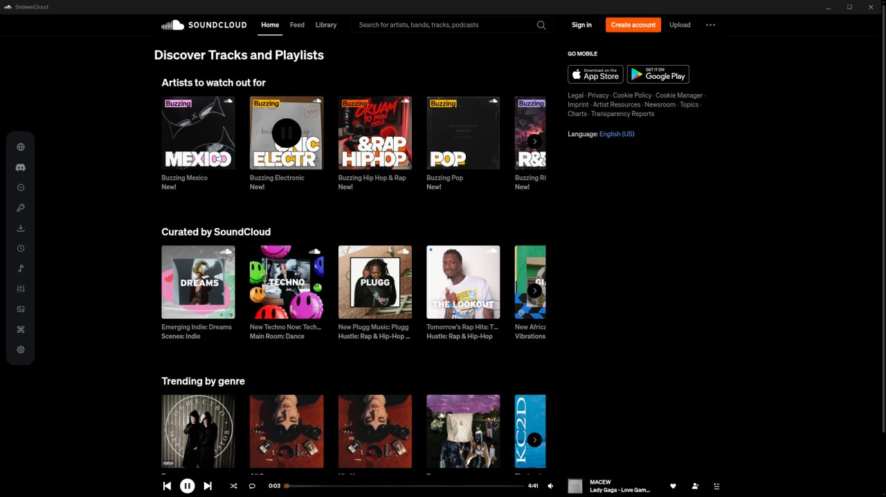
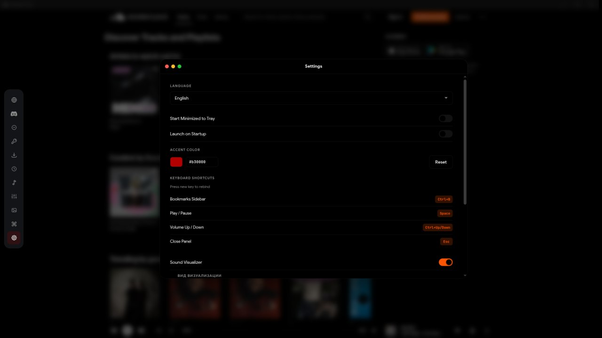
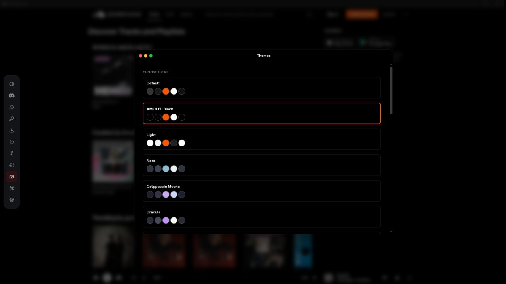
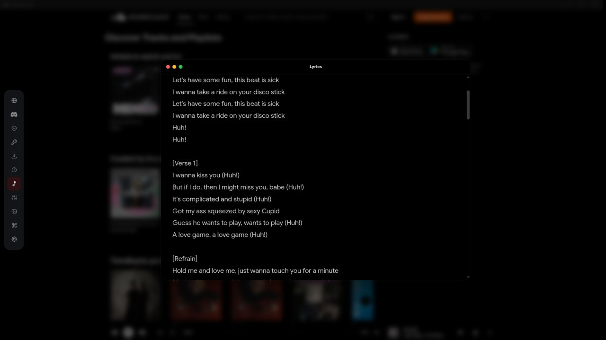
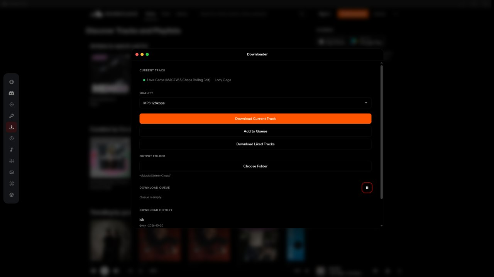
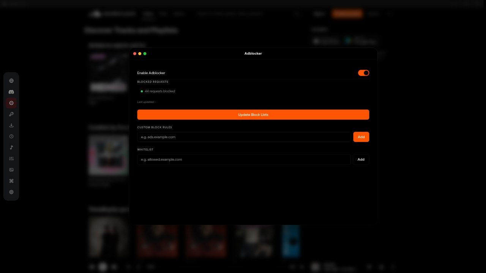
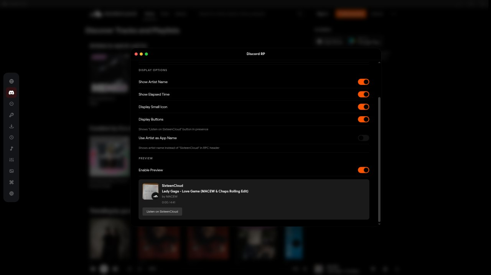

<div align="center">



# SixteenCloud

**A desktop SoundCloud client that feels native.**
Ad-free playback · synced lyrics · 10-band EQ · visualizer · downloads · Discord RPC

[](https://github.com/npukolno/sixteencloud/releases/latest)
[](https://github.com/npukolno/sixteencloud/releases)
[](#install)
[](LICENSE)

[Install](#install) · [Features](#features) · [Screenshots](#screenshots) · [Build from source](#build-from-source)

</div>

---

SixteenCloud wraps the SoundCloud web player in Electron and adds the parts a music app should have: a real tray, media keys and MPRIS on Linux, a proper mini player, offline downloads, synced lyrics, an equalizer, themes and in-app updates. It targets Linux first, with Windows and macOS builds from the same codebase.

> Unofficial client. Not affiliated with, endorsed by, or sponsored by SoundCloud.

## Screenshots



### Settings and appearance

| Settings | Themes |
| :---: | :---: |
| <br>*Language, accent color, keybinds, visualizer* | <br>*Default, AMOLED Black, Light, Nord, Catppuccin Mocha, Dracula* |

### Playback tools

| Synced lyrics | Downloader |
| :---: | :---: |
| <br>*Time-synced lyrics with auto-scroll* | <br>*Queue, quality presets, output folder, history* |

### Integrations and protection

| Adblocker | Discord Rich Presence |
| :---: | :---: |
| <br>*Request blocking, custom rules, whitelist* | <br>*Track, artist, elapsed time and buttons* |

## Features

- **Ad-free playback** — request filtering plus cosmetic cleanup of promoted content.
- **Synced lyrics** — LRC from LRCLIB, NetEase and QQ; plain lyrics from Genius, Musixmatch, lyrics.ovh, AZLyrics, ChartLyrics and lyrist. Auto-scroll with a 3D roulette view.
- **10-band equalizer** — Web Audio graph with presets, per-track persistence.
- **Audio visualizer** — multiple modes, driven by the real analyser node, idle-friendly.
- **Downloads** — tracks and playlists, HLS-aware, with a queue, progress and history.
- **Discord Rich Presence** — current track, artist and artwork.
- **Linux integration** — tray, MPRIS (`org.mpris.MediaPlayer2.sixteencloud`), media keys, desktop entry, notification controls.
- **Bookmarks sidebar** — saved tracks, sets and profiles with quick navigation.
- **Themes & accents** — accent color, dark/light, custom CSS.
- **Geo-unblock** — optional proxy routing for region-locked catalogs.
- **History** — locally stored listening history with search.
- **Auto-update** — Windows and AppImage builds check GitHub Releases (Windows builds are unsigned, so SmartScreen warns before the first run).

## Install

Grab the latest asset from [Releases](https://github.com/npukolno/sixteencloud/releases/latest).

### Windows

Download **`SixteenCloud.Setup.3.0.0.exe`** and run it. The installer is per-user and does not require administrator rights. If SmartScreen warns about an unsigned publisher, choose **More info → Run anyway**.

### Linux

| Format | Install |
| --- | --- |
| **AppImage** | `chmod +x SixteenCloud.Setup.3.0.0.AppImage && ./SixteenCloud.Setup.3.0.0.AppImage` |
| **Debian / Ubuntu** | `sudo dpkg -i SixteenCloud.Setup.3.0.0.deb` then `sudo apt -f install` if needed |
| **Arch / pacman** | `sudo pacman -U SixteenCloud.Setup.3.0.0.pacman` |

On Wayland, if the window does not appear, launch with `--ozone-platform=wayland` or run under XWayland.

### macOS

Download **`SixteenCloud.Setup.3.0.0.zip`**, unzip and drag `SixteenCloud.app` to Applications. The build is unsigned and x86_64 only; clear the quarantine flag once:

```bash
xattr -dr com.apple.quarantine /Applications/SixteenCloud.app
```

## Auto-update

| Build | Update path |
| --- | --- |
| Windows (NSIS) | In-app banner → download → restart. Installs silently. |
| Linux AppImage | In-app banner → download → restart. |
| Linux deb | In-app update downloads the package; installing may require privileges. |
| Linux pacman | Not auto-installed by the app — update the package manually. |
| macOS zip | Manual replacement (unsigned builds cannot self-install). |

Updates are read from GitHub Releases of this repository. Older 2.x builds migrate to 3.0.0 through the same release feed.

## Build from source

Requirements: Node.js 20+ and npm. Linux packaging additionally needs standard Electron build tooling (`fakeroot`, `dpkg`, `rpm` optional); macOS `.dmg` creation must run on macOS.

```bash
git clone https://github.com/npukolno/sixteencloud.git
cd sixteencloud
npm ci
npm run typecheck
npm test
npm start
```

Packaging:

```bash
npm run package:linux   # AppImage + deb + pacman → release/
npm run package          # Windows NSIS → release/ (run on Windows or Wine-capable CI)
npm run package:mac      # macOS zip → release/ (unsigned; run on macOS for signing/notarization)
```

Code-signing material is supplied through electron-builder environment variables or CI secrets. `certs/`, private keys and `release/` are never committed.

## Project layout

| Path | Purpose |
| --- | --- |
| `src/main/` | Electron main process: windows, tray, IPC, updater, downloads, Linux integration |
| `src/preload/` | Sandboxed preload bridges (`preload.ts`, `mini-preload.ts`) |
| `src/renderer/` | Injected overlay UI (titlebar, sidebar, lyrics, EQ, settings, visualizer) |
| `src/shared/` | Types, constants, i18n, user-agent |
| `native/pulse-sixteencloud.c` | `LD_PRELOAD` shim that brands the PulseAudio stream |
| `assets/` | Icons, overlay CSS, fonts, installer artwork |
| `docs/screenshots/` | README screenshots |
| `scripts/` | Preload/pulse-shim bundling and icon generation |

## License

[MIT](LICENSE) © ocb2016 publishing®
